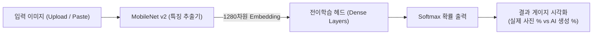

# 🔍 진짜일까? AI 이미지 판별기 (AI vs Real Image Detector)

사용자가 이미지를 업로드하면 사전학습된 **MobileNet v2**와 **TensorFlow.js** 전이학습(Transfer Learning) 딥러닝 분류 모델이 **"실제 사진(Real)"**인지 **"AI 생성 이미지(AI)"**인지 분석하여 확률(%)을 시각적으로 보여주는 순수 웹 서비스입니다.


---

## 🌟 주요 기능

### 1. 🔍 이미지 판별 페이지 (`index.html`)
- **실시간 딥러닝 판별**: MobileNet v2를 통해 이미지의 고차원 특징 벡터를 추출하고 전이학습 모델로 실시간 추론합니다.
- **다양한 입력 지원**:
  - 드래그 앤 드롭 (Drag & Drop)
  - 파일 탐색기 선택
  - **클립보드 붙여넣기 (Ctrl + V)**: 웹 서핑 중 복사한 AI 이미지를 바로 붙여넣어 판별 가능
- **시각적 확률 게이지**: 실제 사진 vs AI 생성 이미지의 확률(%)을 듀얼 컬러 게이지 바로 표시하고 우세한 결과를 하이라이트.
- **접속 세션 판별 기록**: 이번 접속 동안 분석한 이미지 썸네일과 판별 결과를 실시간 목록으로 보관.
- **인간을 위한 AI 구별 팁 6가지**: 손가락 기형, 간판 텍스트 뭉개짐, 배경 직선 왜곡, 인형 같은 피부 질감, 비대칭 안경/장신구, 눈동자 반사광 등 사람이 눈으로 직접 감별하는 노하우 안내.
- **안정적인 모델 로딩 UX**: `./model/model.json` 로딩 상태 인디케이터 표시 및 수동 모델 파일 로더 지원.

### 2. 🧠 모델 학습실 (`train.html`)
- **다중 이미지 업로드**: 실제 사진과 AI 생성 이미지를 드래그 앤 드롭 또는 파일 탐색기로 한 번에 여러 장 업로드 (`multiple` 지원).
- **테스트용 샘플 자동 생성**: 별도 이미지 준비 없이도 원클릭으로 캔버스 기반 샘플 이미지를 자동 생성하여 즉시 학습 테스트 가능.
- **브라우저 기반 전이학습(Transfer Learning)**: 
  - MobileNet v2 특징 추출기(1280차원) + 커스텀 Dense 헤드 레이어 훈련
  - 에포크(Epochs), 배치 크기(Batch Size), 학습률(Learning Rate) 조정 가능
- **실시간 학습 모니터링**:
  - 에포크 진행률 프로그레스 바
  - 실시간 Loss 및 정확도(Accuracy) 메트릭 카드
  - **Chart.js** 실시간 손실/정확도 학습 곡선 그래프 시각화
  - 실시간 콘솔 로그 터미널 창
- **원클릭 모델 내보내기**: 학습 완료 후 `model.json` 및 가중치 바이너리(`model.weights.bin`) 다운로드.

---

## 🛠️ 기술 스택 및 아키텍처

- **Frontend**: 순수 HTML5, CSS3, Modern JavaScript (ES6+)
  - *빌드 도구나 무거운 프레임워크(React, Vue, Webpack 등) 없이 순수 웹 브라우저에서 바로 실행*
- **딥러닝 / AI**:
  - [TensorFlow.js](https://www.tensorflow.org/js) (v4.22.0 CDN)
  - [MobileNet v2](https://github.com/tensorflow/tfjs-models/tree/master/mobilenet) (v2.1.1 CDN)
- **데이터 시각화**: [Chart.js](https://www.chartjs.org/) (v4.4.7 CDN)
- **배포 환경**: [Vercel](https://vercel.com/) (정적 사이트 호스팅)



---

## 📂 프로젝트 구조

```
ai-image-detector/
├── index.html                  # 메인 판별 페이지
├── train.html                  # 모델 전이학습 스튜디오 페이지
├── css/
│   └── style.css               # 모던 반응형 스타일시트
├── js/
│   ├── classifier.js           # MobileNet + 전이학습 추론 엔진
│   ├── trainer.js              # 데이터셋 관리 및 전이학습 훈련 엔진
│   └── ui.js                   # 세션 기록 관리 및 UI 인터랙션 유틸
├── model/                      # 배포용 모델 저장소
│   ├── model.json              # 기본 모델 구조 정의
│   ├── weights.bin             # 사전 생성된 모델 가중치 바이너리
│   └── README.md               # 모델 교체 가이드
├── generate-initial-model.js   # 기본 모델 바이너리 생성 스크립트
├── vercel.json                 # Vercel 배포 라우팅 및 헤더 설정
├── .gitignore                  # 대용량 학습 이미지 폴더(ai, real) 제외 설정
└── README.md                   # 프로젝트 문서
```

---

## 🚀 로컬 실행 방법

별도의 `npm install`이나 빌드 과정 없이, 정적 웹 서버만 있으면 바로 실행할 수 있습니다.

### 방법 1. VS Code Live Server 확장 사용
1. VS Code에서 `ai-image-detector` 폴더를 엽니다.
2. `index.html` 우클릭 &rarr; **Open with Live Server** 클릭.

### 방법 2. Python 내장 웹 서버 사용
터미널에서 아래 명령을 실행합니다:
```bash
# Python 3
python -m http.server 3000
```
브라우저에서 `http://localhost:3000`으로 접속합니다.

### 방법 3. Node.js `npx serve` 사용
```bash
npx serve .
```

> **주의**: TensorFlow.js는 브라우저 보안 정책상 `file:///` 경로에서는 가중치 바이너리 파일을 불러올 수 없으므로(CORS 제한), 반드시 위와 같이 로컬 웹 서버(`http://localhost:...`) 환경에서 열어주세요.

---

## 🎯 모델 학습 및 적용 절차

1. 브라우저에서 `train.html`로 이동합니다.
2. 실제 촬영한 사진들을 **[실제 사진 (Real)]** 영역에 업로드합니다.
3. Midjourney, Stable Diffusion, DALL-E 등으로 생성한 이미지들을 **[AI 생성 이미지 (AI)]** 영역에 업로드합니다.
4. **[🚀 모델 학습 시작]** 버튼을 클릭합니다.
5. 실시간 차트와 손실값, 정확도를 모니터링합니다.
6. 학습이 끝나면 **[💾 모델 저장 (다운로드)]** 버튼을 눌러 `model.json`과 `model.weights.bin`을 내려받습니다.
7. 다운로드받은 파일들을 프로젝트 루트의 `model/` 폴더에 넣고(가중치 파일명을 `weights.bin`으로 지정) 배포하면 사이트에 즉시 반영됩니다.

---

## 🌐 Vercel 배포 방법

본 프로젝트는 Vercel 정적 웹 호스팅 환경에 최적화되어 있습니다.

### 1. GitHub 저장소 생성 및 푸시
```bash
git init
git add .
git commit -m "feat: 진짜일까? AI 이미지 판별기 최초 릴리즈"
git branch -M main
git remote add origin https://github.com/<사용자명>/ai-image-detector.git
git push -u origin main
```
*(참고: `.gitignore` 설정에 따라 대용량 학습 폴더인 `ai/`, `real/`, `dataset/`은 자동으로 배포 대상에서 제외됩니다.)*

### 2. Vercel 배포
1. [Vercel](https://vercel.com)에 로그인 후 **"Add New..." &rarr; "Project"**를 클릭합니다.
2. GitHub에서 방금 푸시한 `ai-image-detector` 저장소를 선택(Import)합니다.
3. **Framework Preset**: `Other` (기본값)
4. **Build and Output Settings**: 기본값 유지 (빌드 명령어 불필요)
5. **Deploy** 버튼 클릭!
6. 배포가 완료되면 발급된 고유 URL(예: `https://ai-image-detector.vercel.app`)로 전 세계 어디서나 접속할 수 있습니다.

---

## 📄 라이선스
MIT License
